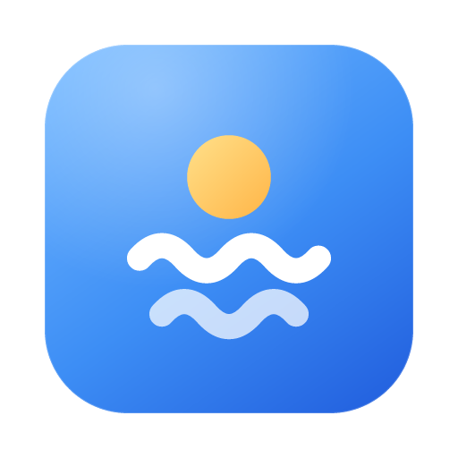
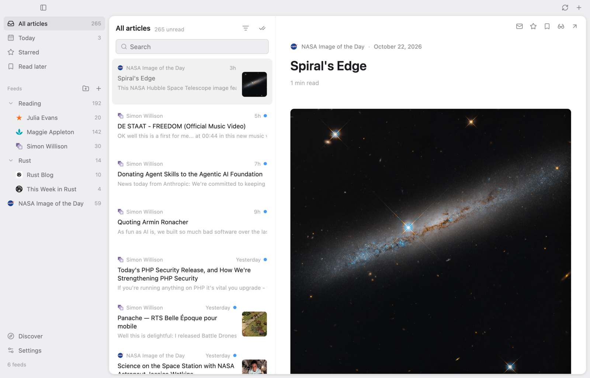
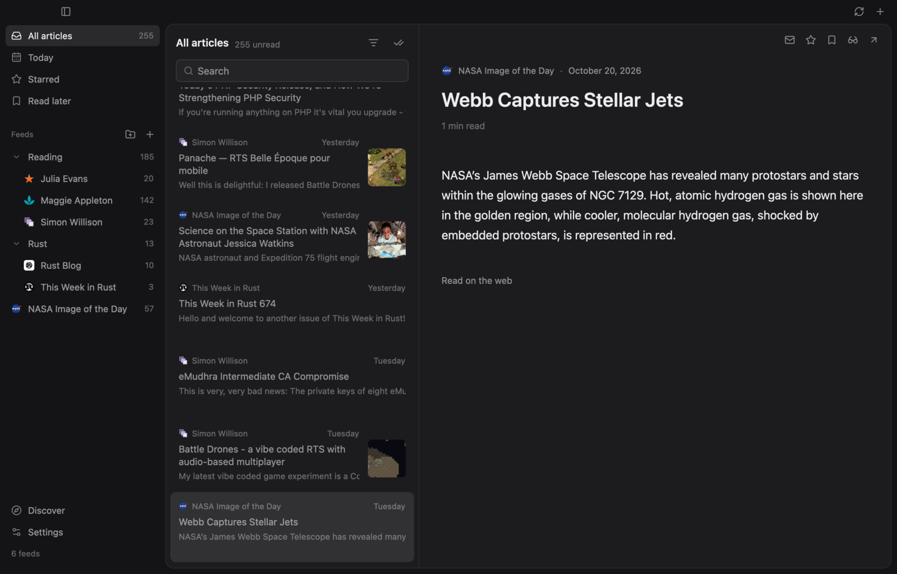
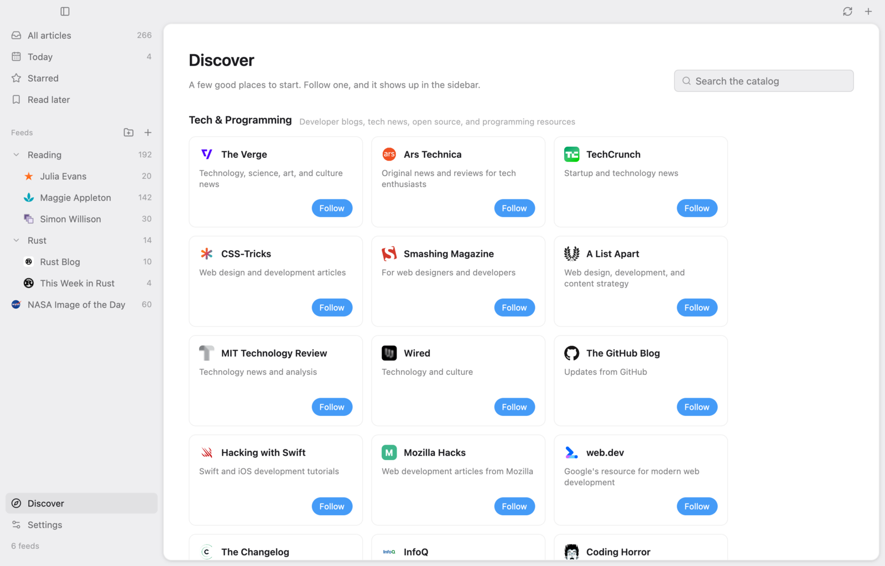

<p align="center">
  
</p>

<h1 align="center">Brook</h1>

<p align="center">A calm, local RSS reader for macOS and Linux.</p>



Brook follows the sites you choose and nothing else. No accounts, no algorithm, no server: your subscriptions and everything you read live in one SQLite file on your computer, and Brook talks only to the sites you follow (and to GitHub, once a day, to see whether there's a new version).

It's written in Rust with [GPUI](https://www.gpui.rs), the GPU-accelerated UI framework from Zed.

> Brook used to be CozyRSS, a self-hosted web app. It's been rebuilt from the ground up as a native desktop app.

## What it does

- **Follows anything with a feed.** RSS, Atom, and JSON Feed. Paste a feed, a home page, a bare domain, or a YouTube channel; Brook finds the feed and shows what it publishes before you follow it.
- **Reads well.** Articles are typeset in one calm column with real headings, quotes, lists, code, images, and video cards. When a feed only sends a summary, **reader mode** pulls the full article from the web page.
- **Stays out of the way.** Unread counts, a Today view, stars, and a Read later list. Feeds refresh quietly in the background, and only changed feeds are downloaded again.
- **Keeps you organized.** Folders, rename and move from a right-click, search across everything you've fetched, and OPML import and export to move between readers.
- **Helps you start.** Discover is a hand-picked catalog of more than a hundred feeds, built into the app, one click to follow.
- **Lives on your keyboard.** `J` and `K` move, `S` stars, `L` saves for later, `V` toggles reader mode, `/` searches. The full list is in Settings.
- **Looks at home.** Light and dark themes that follow the system, and on macOS in dark mode, a window of soft glass.





## Install

Download the latest build from [Releases](https://github.com/dyascj/cozy-rss/releases/latest).

**macOS** (13 Ventura or later, Apple silicon and Intel): unzip `Brook.zip` and drag Brook to Applications. The app is signed ad hoc rather than notarized, so the first time, right-click it and choose **Open**, or run:

```sh
xattr -dr com.apple.quarantine /Applications/Brook.app
```

**Linux** (x86_64 and arm64, X11 or Wayland):

```sh
tar -xzf Brook-linux-x86_64.tar.gz
./brook/install.sh
```

That puts `brook` in `~/.local/bin` and adds Brook to your app launcher. `./brook/install.sh --uninstall` removes it.

### Updates

Brook checks GitHub for a new version once a day. When there is one, an **Update** button appears in the title bar; it downloads the new build, checks its signature against a key built into the app, swaps it in, and restarts. Turn the daily check off in Settings. Development builds never update themselves.

## Your data

| | macOS | Linux |
| --- | --- | --- |
| Library | `~/Library/Application Support/Brook/brook.db` | `~/.local/share/brook/brook.db` |
| Images and icons | `~/Library/Caches/Brook` | `~/.cache/brook` |

Back up the library by copying the `.db` file while Brook is closed. To leave, export OPML from Settings and every other reader can take it from there. Bodies of articles you've read are dropped after 90 days to save space; starred and saved articles are kept whole.

## Build from source

You need Rust 1.90 or later. On Linux, first install GPUI's system libraries (`scripts/linux-deps.sh` does it on Debian and Ubuntu).

```sh
cargo run -p brook
```

Try it without touching your real library by pointing it somewhere else:

```sh
BROOK_DATA_DIR=/tmp/brook-scratch cargo run -p brook
```

Run the checks CI runs:

```sh
cargo fmt --all --check
cargo clippy --workspace --all-targets
cargo test --workspace
```

## How it's put together

Two crates:

- **`brook-core`** has no UI. It stores everything in SQLite, fetches and parses feeds, finds feeds for a website, refreshes, reads and writes OPML, extracts articles for reader mode, turns article HTML into a typeset-ready document, and checks for updates. It's synchronous and tested against a small local HTTP server.
- **`brook`** is the GPUI app: the window, the views, and the glue that runs `brook-core`'s work on background threads.

[docs/ARCHITECTURE.md](docs/ARCHITECTURE.md) walks through both. [docs/DESIGN.md](docs/DESIGN.md) covers the visual language, and [docs/RELEASING.md](docs/RELEASING.md) how a release is cut and signed.

## License

[MIT](LICENSE)
